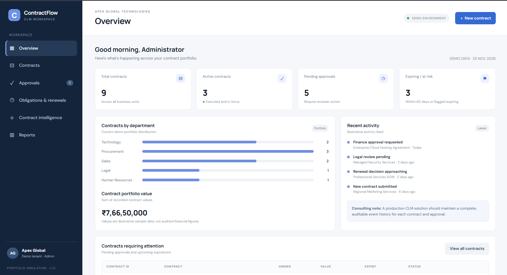
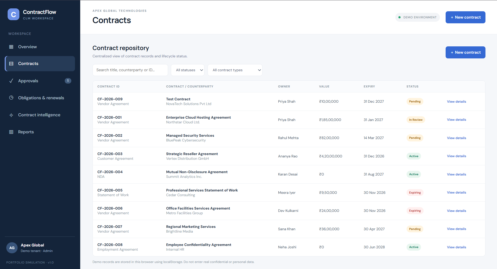
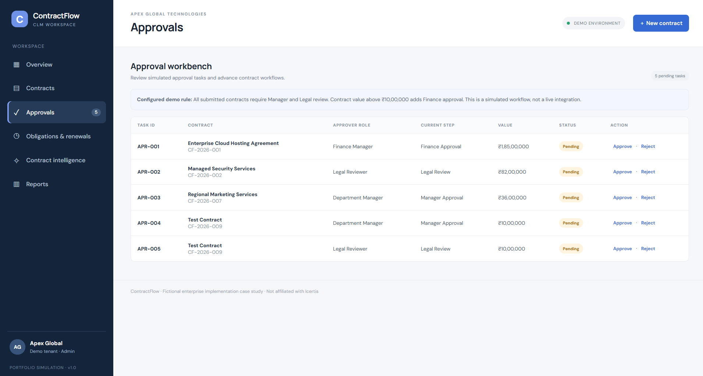

# ContractFlow — Contract Lifecycle Management (CLM)

**A Functional Consulting Portfolio Project | Fictional Client: Apex Global Technologies**

[**Live Demo**](https://contractflow-clm.vercel.app) · [**GitHub Repository**](https://github.com/Nisarga0104/ContractFlow-CLM)

---

## 1. Project Overview

ContractFlow is an independently developed Contract Lifecycle Management (CLM) implementation simulation designed to demonstrate how a Functional Consultant approaches enterprise contract management challenges.

The project models a fictional multinational organization's contract lifecycle, from contract intake and approval routing to obligation tracking, renewals and portfolio reporting.

It combines functional consulting documentation with a working browser-based prototype.

## 2. Business Problem

Organizations managing contracts through disconnected spreadsheets, email approvals and manual tracking can face:

- Delayed contract approval cycles.
- Limited visibility into contract status and ownership.
- Inconsistent approval processes.
- Missed renewal dates and contractual obligations.
- Difficulty identifying contractual risks.
- Fragmented contract reporting.

**Proposed solution:** A centralized CLM workflow simulation that demonstrates structured contract intake, approval routing, obligation monitoring and management reporting.
## Application Screenshots

### Executive Dashboard


### Contract Repository


### Approval Workflow


### Obligations & Renewals


## 3. Key Features

| Module | Functionality |
|---|---|
| Executive Dashboard | Contract portfolio KPIs and activity overview |
| Contract Repository | Contract listing, search and detail views |
| Contract Creation | Structured contract intake and submission |
| Approval Management | Simulated Manager, Legal and Finance approval workflows |
| Obligations & Renewals | Obligation ownership, due dates and completion tracking |
| Contract Intelligence | Rule-based risk review queue and checklist |
| Reports | Contract statistics and CSV export |

### Approval Workflow Logic

The prototype demonstrates value-based approval routing:

- Manager approval: required.
- Legal review: required.
- Finance approval: additionally required for contract values above ₹10,00,000.

## 4. Technology Stack

- HTML5
- CSS3
- JavaScript
- Browser Local Storage
- Git and GitHub
- Vercel

The application is a static front-end prototype and does not require a backend server or database.

## 5. Functional Consulting Deliverables

The repository includes implementation documentation covering:

- Project charter and scope definition.
- Business Requirements Document (BRD).
- Stakeholder analysis.
- AS-IS and TO-BE process design.
- Functional Requirements Document (FRD).
- Workflow and configuration design.
- Data migration mapping.
- Functional test scenarios.
- User Acceptance Testing (UAT).
- Deployment and handover planning.
- Interview walkthrough.

See the `docs/` folder for the detailed consulting artifacts.

## 6. Demo Walkthrough

1. Open the executive dashboard.
2. Navigate to the contract repository.
3. Create and submit a new contract.
4. Observe the approval tasks generated by the workflow rules.
5. Approve or reject an approval task.
6. Complete an obligation.
7. Review the contract intelligence queue.
8. Open reports and export contract records as CSV.

## 7. Project Structure

```text
ContractFlow-CLM/
│
├── index.html
├── styles.css
├── app.js
├── vercel.json
├── README.md
│
├── assets/
├── data/
├── docs/
├── tests/
│
└── .gitignore
```

## 8. Known Limitations

This project is an educational Functional Consulting simulation, not a production CLM platform.

- Contract records are stored in browser Local Storage.
- Data is not shared across users or devices.
- Authentication and role-based authorization are not implemented.
- No backend API or centralized database is connected.
- Approval actions are simulated and are not legally binding.
- Contract Intelligence uses demonstration rules and metadata, not a trained AI model or automated contract parser.
- The review checklist is currently illustrative rather than a fully interactive review workflow.
- Sample contracts, values, client names and metrics are fictional.

A production implementation would require backend services, database integration, identity and access management, audit logging, security controls, document management and integration with enterprise systems.

## 9. Business Value Demonstrated

This project demonstrates the ability to:

- Translate business problems into functional requirements.
- Design enterprise workflow logic.
- Define approval matrices and business rules.
- Structure contract lifecycle processes.
- Prepare functional testing and UAT scenarios.
- Document configuration and migration requirements.
- Communicate implementation scope and limitations.

## 10. Important Disclaimer

ContractFlow is an independently created educational simulation. It is not Icertis software, is not connected to the Icertis platform and does not demonstrate hands-on Icertis configuration.

All client names, contract records, workflow rules and sample metrics are fictional. This project is not legal advice.

---

**Project:** ContractFlow — CLM Functional Implementation Simulation  
**Category:** Functional Consulting | Business Analysis | Contract Lifecycle Management  
**Deployment:** Vercel  
**Source Code:** GitHub