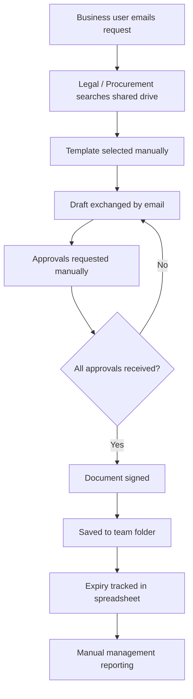
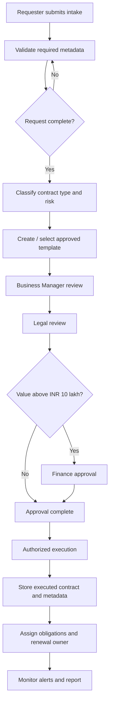

# Process Design — AS-IS and TO-BE

## AS-IS: fragmented contract process

## TO-BE: governed CLM process

## Workflow definition

| Step | Actor | Input | Action | Output / control |
|---|---|---|---|---|
| Intake | Requester | Business need, counterparty, type, value, dates | Submit request | Request ID; mandatory fields |
| Completeness | System / coordinator | Submitted fields | Validate required metadata | Complete / returned |
| Manager review | Department manager | Request and business rationale | Approve / reject / return | Decision and comment |
| Legal review | Legal reviewer | Draft, template, deviations | Review clauses and terms | Legal approval / redline |
| Finance review | Finance approver | Value and financial terms | Validate commitment | Finance decision when threshold applies |
| Execution | Authorized signatories | Final approved version | Execute through approved process | Execution evidence |
| Repository | Contract administrator | Executed agreement | Store record and metadata | Searchable record |
| Obligation management | Contract owner | Contract terms | Assign obligations and dates | Owner and reminders |
| Renewal | Business owner / Legal | Notice terms and business need | Renew, renegotiate or terminate | Recorded decision |

## Exception paths

- Rejected request: return to requester with reason; retain history.
- Legal deviation: escalate to designated legal authority.
- Threshold exception: never bypass without documented authorized exception.
- Incomplete migration record: quarantine for remediation; do not silently import.
- Renewal owner missing: escalate before migration/go-live.
- Expired agreement: preserve historical record; do not treat as active.

## Process controls

- Segregation of duties for requester, approver and administrator where required.
- Approval delegation rules documented and time-bound.
- Immutable audit events in production.
- Version control for drafts and executed documents.
- Role-based access and confidential contract restrictions.
